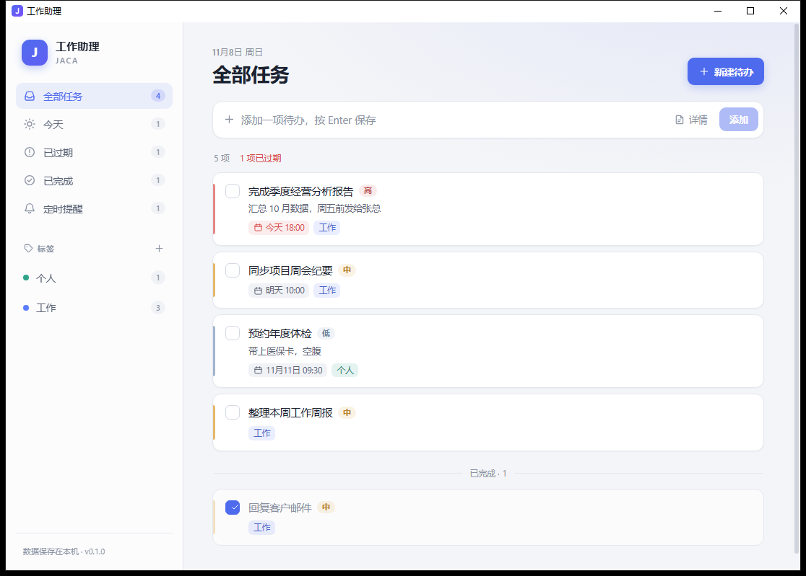
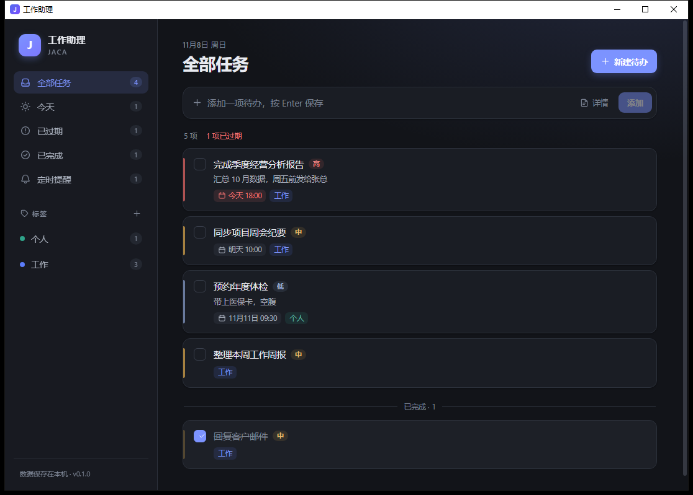

# 工作助理（Jaca）

一款专注日常工作的 Windows 桌面待办与定时提醒应用。基于 Tauri 2 + React 19 + TypeScript + SQLite 构建，安装包约 2.4 MB，数据完全保存在本机。

[](LICENSE)
[](#)
[](https://tauri.app)



## 功能

- **待办管理**：添加、编辑、删除、标记完成，支持备注
- **优先级与截止时间**：高 / 中 / 低优先级，过期任务醒目提示
- **标签归类**：为任务打标签，侧边栏一键筛选
- **智能视图**：全部 / 今天 / 已过期 / 已完成，实时数量统计
- **定时提醒**：按分钟或小时重复提醒（例如每 10 分钟提醒喝水），支持启用 / 暂停
- **后台驻留**：点击关闭窗口自动隐藏到系统托盘，提醒不中断
- **系统通知**：触发提醒时弹出 Windows 通知（带提示音）和应用内横幅
- **深色模式**：自动跟随系统主题
- **本地优先**：无需账号，数据只存在本机

## 截图

| 浅色 | 深色 |
| --- | --- |
|  |  |

## 下载安装

前往 [Releases](https://github.com/kusanyao/jaca/releases/latest) 下载最新的 `jaca_*_x64-setup.exe` 安装。

> 安装包未做代码签名，Windows SmartScreen 可能提示「未知发布者」，点击「更多信息 → 仍要运行」即可。

系统要求：Windows 10 / 11（WebView2 运行时通常已随系统内置）。

## 使用说明

### 待办

- 在顶部输入框输入内容，按 `Enter` 快速添加
- 点击「详情」或任务正文，可设置备注、优先级、截止时间和标签
- 勾选左侧复选框标记完成

### 定时提醒

- 在侧边栏进入「定时提醒」→「新建提醒」
- 设置提醒内容、说明和间隔（例如每 10 分钟）
- 暂停 / 启用开关可随时控制
- 窗口隐藏到托盘后仍会按计划触发系统通知

### 系统托盘

- 点击窗口关闭按钮：隐藏到托盘，不退出应用
- 左键单击托盘图标：重新显示窗口
- 右键托盘菜单：「打开工作助理」/「退出」

## 技术栈

| 模块 | 技术 |
| --- | --- |
| 桌面框架 | [Tauri 2](https://tauri.app) |
| 前端 | React 19 + TypeScript + Vite |
| 待办数据 | SQLite（[tauri-plugin-sql](https://v2.tauri.app/plugin/sql/)） |
| 提醒数据 | JSON 本地文件 |
| 通知 | tauri-plugin-notification（Windows Toast） |
| 图标 | 由 SVG 通过 `tauri icon` 生成 |

## 开发

### 环境要求

- Node.js 20+
- Rust stable（MSVC 工具链）
- Visual Studio 2022 C++ 生成工具
- WebView2 运行时（Windows 10 / 11 一般已内置）

### 启动开发

```bash
npm install
npm run tauri dev
```

> 开发模式下关闭窗口只会隐藏到托盘，退出请使用托盘菜单「退出」或在终端按 `Ctrl+C`。

### 构建安装包

```bash
npm run tauri build
```

产物位于 `src-tauri/target/release/bundle/nsis/`。

> 国内网络下若 Rust 依赖下载较慢，可在 `.cargo/config.toml` 中配置 crates.io 镜像（例如 rsproxy）后重试。

## 数据存储

```
%APPDATA%\com.jaca.workassistant\jaca.db          # 待办与标签（SQLite）
%APPDATA%\com.jaca.workassistant\reminders.json   # 定时提醒
```

备份或迁移时复制以上两个文件即可。

## 项目结构

```
src/                        # React 前端
├─ components/              # 侧边栏、待办列表、编辑器、提醒视图、弹窗
├─ hooks/                   # useTodos / useReminders
├─ lib/                     # 数据库访问、日期格式化
├─ types.ts                 # 共享类型
└─ styles.css               # 全部界面样式
src-tauri/                  # Tauri 后端
├─ src/lib.rs               # SQLite 迁移、提醒调度器、托盘与通知
├─ capabilities/default.json# 权限配置
├─ icons/                   # 应用图标
└─ tauri.conf.json          # 窗口与打包配置
```

## 已知限制

- 仅支持 Windows
- 安装包未签名，首次运行会有 SmartScreen 提示
- 暂未实现单实例限制，重复启动会打开多个窗口
- 定时提醒的检查粒度为 10 秒，触发时间可能有最多约 10 秒延迟

## 贡献

欢迎提交 Issue 和 Pull Request。

## 许可证

[MIT](LICENSE)
